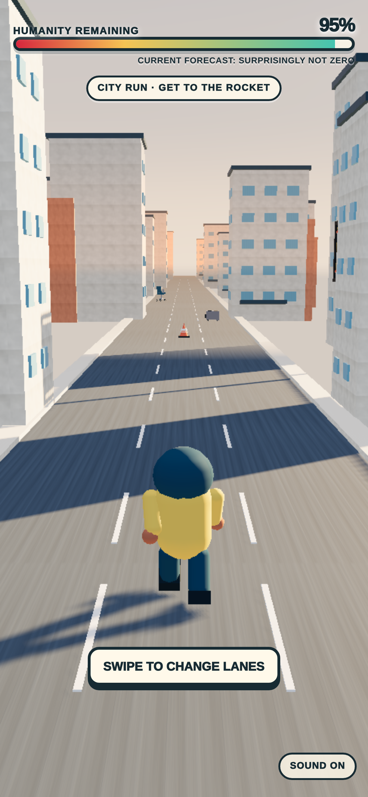

# No Lunch Left Behind

A missing lunch. A very literal robot coworker. An entirely disproportionate apocalypse.

A mobile-first Three.js game built for 404 Game Jam 001: leave the office, escape through a city, fly to an orbital station, and reach the master switch.

**[Play in your browser](https://no-lunch-left-behind.vercel.app)**



*Development capture from this repository. The hosted game is a separately deployed build; this image does not certify that the current source and hosted version are identical.*

## What I built

The project brings together a comic premise, procedural Three.js scenes, character animation, touch and keyboard controls, synthesized audio, and a continuous story across city, space, and station sequences. It was developed with AI-assisted asset and coding workflows; [asset provenance](docs/ASSET_PROVENANCE.md) records the creative process and sources.

The design challenge was keeping the next action legible on a small screen while the scale of the story keeps growing. Scene transitions, cues, and the ending are part of the game, rather than separate menus.

## Run locally

No package installation or runtime API key is needed. With Python 3:

```bash
python -m http.server 8080 --directory game
```

Open <http://localhost:8080>. Use a phone-sized viewport to try the touch controls.

Ground sections use swipes to change lanes, jump, and slide; keyboard controls use arrows or WASD. Space flight uses a drag joystick or held directional keys. Follow the on-screen prompts for scene-specific interactions.

## Engineering and verification

The game ships as static files with local assets. Small modules separate input, animation, mission rules, and results from scene orchestration.

Run the existing Node.js tests:

```bash
node --test tests/*.test.mjs
```

These cover input mapping, character motion, story timing, mission stakes, collision audio, boarding, and result grading. They complement playtesting; they do not establish a public mobile performance-gate pass.

## Explore further

- [Development review captures](review/README.md)
- [Asset provenance](docs/ASSET_PROVENANCE.md)
- [Creative decisions](docs/DECISIONS.md)
- [Jam-era README and submission context](docs/JAM_HISTORY.md)
- [Build coordination and recorded verification](docs/NOW.md)

Public hosting remains separate from source updates. Historical performance observations apply to the builds identified in the development records.
